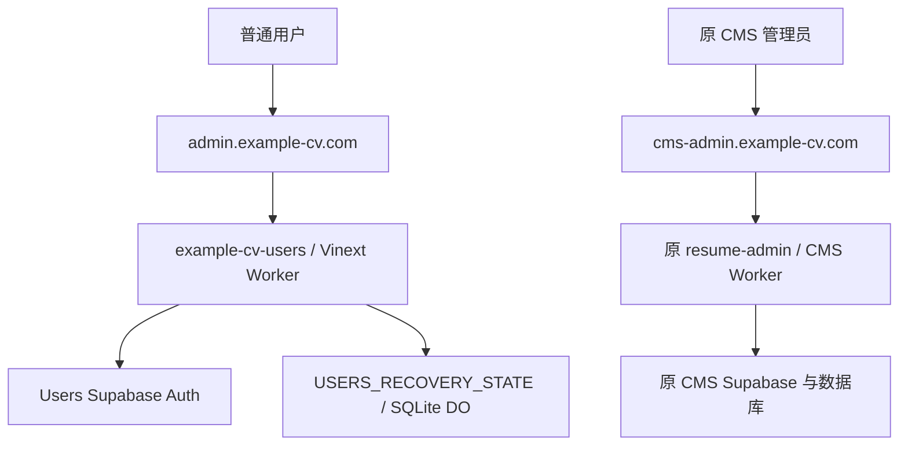

# 应用架构

> **2026-11-07 现状补充：** 下方“目标结构，尚未部署”属于原架构快照。前置只读查询已确认Users、CMS和Public各自的生产域名映射，详见[生产上线结项记录](S2-PRODUCTION-CLOSEOUT-2026-11-07.md#1-生产与源码基线)。
>
> 本文末尾的Wrangler描述仍是仓库安全默认配置；[生产配置与回退边界](S2-PRODUCTION-CLOSEOUT-2026-11-07.md#5-生产配置邮件与回退边界)另行记录，不以源码声明推定云端状态。

## 两个应用、两个身份域

以上是批准的目标结构，尚未部署。Users 固定项目为 `example-cv-users / makwjnbubmrmopjhzror`。原 CMS 继续使用自己的项目、配置、AuthGate、Owner/Test 权限及数据。没有账户合并、邮箱关联授权或跨项目密码回退。

页面位于 `app/`，共享表单位于 `app/_components/`；`worker/index.ts` 负责根入口、私有 SSR、静态资源与 API 分发；`lib/account/api.ts` 执行业务；`lib/auth/session.ts` 逐请求创建官方 SDK 和 Cookie 写缓冲。新应用不导入旧 CMS 认证或数据客户端，旧管理 API 返回 JSON 404，不向另一主机转发携带凭据的请求。

S2 界面/CSS 来源为既有账户视觉预览和已验证原型，迁入后只做 Vinext/API 适配；服务端 Cookie 与持久状态适配保留在新包。原型和历史设计基准留在本机历史目录，既有视觉认可及五项明确接受的差异保留。根路径没有身份选择页。

## 会话与防伪

`__Host-ecv-users-session`、`recovery`、`tx`、`grant` 各自隔离；Secure、HttpOnly、SameSite=Lax、Path=/、无 Domain。浏览器不读取 HttpOnly 凭据进行另一套客户端刷新。每次身份校验检查签名声明、issuer/audience、UID/session ID，再经 getUser 核对已确认邮箱。

写 API 要求精确可信 Origin、JSON 和字段白名单，并拒绝跨站请求。允许返回地址仅 `/account`。私有 SSR/API 为 private/no-store，用户上下文按请求隔离。两个子域仍为 same-site，因此 SameSite 或路径不能代替严格来源与授权校验。

## 恢复状态与一次性授权

流程保持 `resetPasswordForEmail` → 服务端 `verifyOtp(type: recovery)` → 本次邮箱、User/Session、签名声明与 getUser → 一次性授权 → 普通 `updateUser`。已有普通登录不能代替验码，不使用管理员重置接口。

`worker/recovery-state.ts` 使用真实 SQLite DO。稳定映射为 `account:v1:SHA256(projectRef + NUL + normalizedEmail)`；邮箱只 trim/lowercase，不合并别名。不同账户不共用全局锁。

关键状态包含事务阶段、期限、尝试次数、授权摘要和身份绑定，不存明文密码/验证码或访问、刷新令牌。消费在 `transactionSync` 内检查状态与期限、写 `attempted`，随后 `storage.sync()`；外部 PUT 必须等待持久领取。UNKNOWN、丢响应或中断都不能将同一授权恢复为 ready。DO 与 Supabase 不构成跨服务事务，可能发生“授权耗用而密码未确认更新”，只能按明确分支独立核对，不自动重改。

OTP 120 秒由上游裁定，重发至少 60 秒，验码后授权 600 秒；使用时检查过期，alarm 仅辅助清理。这些不是 JWT 生命周期，也不是全入口严格 B 或整窗签发互斥承诺。

## 工具与应用边界

`scripts/local.mjs`、`tests/` 仅提供隔离上游。`scripts/local-https.mjs` 是合成会话诊断；`controlled-https.mjs` 仅用于另行批准的受控真实批次。两者通过 `scripts/https/` 使用固定公开身份 pins 和包内本地材料位置，不导入历史目录。

专用批次账户使用摘要绑定，仅存在工具层，不成为正式普通用户白名单。正式 Worker 不导入这些启动器、测试夹具或本地信任工具。`wrangler.jsonc` 仍 disabled、无正式路由和远程绑定。
