# S3.2：逻辑模型、字段与约束

状态：INFERRED / REVIEWED DESIGN。表名为候选；**没有创建任何表、Migration或执行SQL，所有新约束NOT TESTED**。
首版规范化私有草稿+聚合API+不可变版本/发布快照；不为未来HR提前重构全部编辑字段。

## Schema职责

- site_data：sites/member/domain、内容、资产、版本及发布对象，不直接暴露Data API。
- site_private：security/grants/proofs、幂等、内部审计、上传/清理，不暴露。
- site_api：显式批准后最小暴露的读取视图/RPC。
不暴露Schema不能替代GRANT/RLS；底层视图执行需要的权限必须明示。

## 逻辑ERD

```mermaid
erDiagram
    AUTH_USERS ||--|| USER_SECURITY_STATE : security
    AUTH_USERS ||--o{ BUSINESS_SESSION_GRANTS : sessions
    AUTH_USERS ||--o| SITES : owns_first_version
    AUTH_USERS ||--o{ SITE_MEMBERS : joins
    SITES ||--|{ SITE_MEMBERS : members
    SITES ||--o{ SITE_DOMAINS : domains
    SITES ||--|| SITE_SETTINGS : settings
    SITES ||--|{ SITE_LOCALES : languages
    SITE_LOCALES ||--o{ SECTION_TRANSLATIONS : labels
    SITES ||--|| PROFILES : profile
    PROFILES ||--o{ PROFILE_TRANSLATIONS : translates
    SITES ||--o{ INTRO_ENTRIES : intros
    INTRO_ENTRIES ||--o{ INTRO_TRANSLATIONS : translates
    SITES ||--o{ EDUCATION_ENTRIES : education
    EDUCATION_ENTRIES ||--o{ EDUCATION_TRANSLATIONS : translates
    SITES ||--o{ EXPERIENCE_ENTRIES : experience
    EXPERIENCE_ENTRIES ||--o{ EXPERIENCE_TRANSLATIONS : translates
    SITES ||--o{ PROJECT_ENTRIES : projects
    PROJECT_ENTRIES ||--o{ PROJECT_TRANSLATIONS : translates
    PROJECT_ENTRIES ||--o{ PROJECT_METHODS : methods
    SITES ||--o{ SKILL_GROUPS : skills
    SKILL_GROUPS ||--o{ SKILL_TRANSLATIONS : translates
    SITES ||--o{ AWARD_ENTRIES : awards
    AWARD_ENTRIES ||--o{ AWARD_TRANSLATIONS : translates
    SITES ||--|| CONTACT_SETTINGS : contact
    CONTACT_SETTINGS ||--o{ CONTACT_TRANSLATIONS : translates
    SITES ||--o{ CONTACT_FOCUS_ITEMS : focus
    CONTACT_FOCUS_ITEMS ||--o{ CONTACT_FOCUS_TRANSLATIONS : translates
    SITES ||--o{ CONTACT_STATUS_ITEMS : status
    CONTACT_STATUS_ITEMS ||--o{ CONTACT_STATUS_TRANSLATIONS : translates
    SITES ||--o{ NAVIGATION_ITEMS : navigation
    NAVIGATION_ITEMS ||--o{ NAVIGATION_TRANSLATIONS : translates
    SITES ||--o{ SITE_LINKS : links
    SITES ||--o{ SITE_ASSETS : assets
    SITE_ASSETS ||--o{ SITE_DOCUMENTS : documents
    SITE_ASSETS ||--o{ ASSET_UPLOAD_INTENTS : upload
    SITE_ASSETS ||--o{ ASSET_CLEANUP_JOBS : cleanup
    AUTH_USERS ||--o{ GRANT_PROOFS : signs
    SITES ||--|{ SECTION_STATE : versions
    SITES ||--o{ OPERATION_REQUESTS : operations
    SITES ||--o{ DRAFT_REVISIONS : history
    SITES ||--o{ SITE_AUDIT_EVENTS : audits
    SITES ||--o{ PUBLISHED_SNAPSHOTS : snapshots
    PUBLISHED_SNAPSHOTS ||--o{ SNAPSHOT_ASSETS : includes
    SITE_ASSETS ||--o{ SNAPSHOT_ASSETS : references
    SITES ||--|| SITE_PUBLICATIONS : permanent_state
    SITES ||--o{ PUBLICATION_OUTBOX : invalidates
    PUBLISHED_SNAPSHOTS o|--o| SITE_PUBLICATIONS : current_pointer
```

Auth指Users项目；真实站点历史/账号删除生命周期需明确，不对所有关系一律CASCADE。
ERD表示逻辑职责；下表的复合键/可空约束优先于图的简化基数。

## 通用字段约定

- S=site_id UUID NOT NULL，FK→sites(id)。
- E=重复条目id UUID PK，并有UNIQUE(site_id,id)。
- C=created_at/updated_at timestamptz，由数据库维护；只追加历史可仅created_at。
- O=position integer >=0，列表作用域内唯一；不能以position代替record ID。
- T=翻译PK(site_id,parent_id,locale)，复合FK(site_id,parent_id)→父表，FK(site_id,locale)→site_locales。
- 首版locale仅zh/en；“翻译行缺失”、空字符串、显式删除不混淆。
- 归属site、owner、parent普通不可变；actor是可信审计信息，不承担所有权。
- 受约束role/status/kind/section，未知值拒绝；快照JSON有schema_version、白名单和大小/深度限制。
- 核心ID/状态/版本/时间非空；业务空值按表明确，不能把展示层默认值当数据库事实。

## 身份与站点字段字典

| 对象 | 字段 | PK/唯一/FK与限制 |
|---|---|---|
| user_security_state | auth_user_id,security_epoch bigint,business_enabled,security_hold,C | PK UID，FK Auth；epoch单调不回退 |
| business_session_grants | id,auth_user_id,auth_session_id,security_epoch,purpose,issued_at,last_renewed_at,expires_at,absolute_expires_at,可空revoked_at/reason,issuer_version | PK id；UID+session唯一；purpose=business；不存Token |
| grant_proofs | proof_id,UID,session_id,action,epoch,request_digest,issued/expires/consumed_at,key_id | PK proof；一次消费；consumed_at可空 |
| sites | id,owner_auth_user_id,status,draft_revision,C,可空deleted_at | PK id；Auth FK；首版owner唯一 |
| site_members | S,auth_user_id,role,state,C | PK site+UID；Auth FK；每站点恰好active owner |
| site_domains | E,S,hostname_normalized,kind,state,is_primary,可空verified_at,C | hostname全局唯一；每站点至多一个启用primary |
| site_settings | S,default_locale,theme_key,受限theme_options,C | PK site；默认语言FK本站locale |
| site_locales | S,locale,enabled,C | PK site+locale；初始化zh/en |
| section_translations | S,locale,section_key,heading,可空subtitle,C | PK site+locale+section |
| section_state | S,section_key,revision bigint,updated_at | PK site+section；revision>=0 |

user_profiles并非首版必需：Auth仅提供身份，职业Profile按site保存；若未来添加私人用户偏好，单列本人权限，不能混公开Profile。

## 内容字段字典

| 对象 | 业务字段（另含通用字段） | 关系/唯一作用域 |
|---|---|---|
| profiles | S,graduation_value,avatar_initials,footer_name,copyright,可空photo_asset_id,C | PK site；同站asset FK |
| profile_translations | S,locale,name,nav_about_label,email_action_label,graduation_label,avatar_label,contact_focus_heading,contact_status_heading,C | PK site+locale；profiles/locales FK |
| intro_entries | E,S,O,可空source_key,C | site排序唯一 |
| intro_translations | T,text,C | parent=intro |
| education_entries | E,S,O,entry_type,可空education_category/source_key,C | category/entry_type白名单与组合校验 |
| education_translations | T,title,program,period,grade,可空course_title/course_description/custom_category_label,C | parent=education |
| experience_entries | E,S,O,可空source_key,C | site排序唯一 |
| experience_translations | T,organization,title,period,description,可空location,C | parent=experience |
| project_entries | E,S,O,可空source_key,C | site排序唯一 |
| project_translations | T,title,subtitle,period,description,href,C | parent=project，URL校验 |
| project_methods | E,S,project_id,locale,O,value,C | 同站project/locales FK；site+project+locale内排序唯一 |
| skill_groups | E,S,O,可空source_key,C | site排序唯一 |
| skill_translations | T,title,items_text,C | parent=skill；保留旧文本语义 |
| award_entries | E,S,O,可空source_key,C | site排序唯一 |
| award_translations | T,name,year_text,C | parent=award |
| contact_settings | S,C | PK site；Auth邮箱不自动同步 |
| contact_translations | S,locale,contact_label,availability,C | PK site+locale；contact/locales FK |
| contact_focus_items | E,S,O,C | site排序唯一 |
| contact_focus_translations | T,title,detail,C | parent=focus |
| contact_status_items | E,S,O,status_type,C | study/graduation/open白名单 |
| contact_status_translations | T,title,detail,C | parent=status |
| navigation_items | E,S,O,section_key,enabled,C | site+section唯一，支持模块白名单 |
| navigation_translations | T,label,C | parent=navigation |
| site_links | E,S,kind,可空locale,label,display_value,target,O,C | 同站locale、kind/scheme校验，明确共享locale=NULL去重 |

教育保留undergraduate/graduate/doctoral/summerSchool/custom；period/year首版保留展示文本。
site_links通过mapper适配旧shared/translations；NULL唯一语义必须显式设计，不能假定普通UNIQUE能阻止共享链接重复。
栏目标题从locale大表拆出；PDF不再同时由links/portfolio_href和文件页维护。

## 文件、版本、审计、发布字典

| 对象 | 字段 | 键/约束 |
|---|---|---|
| site_assets | E,S,bucket_id,object_key,kind,original_filename,mime_type,byte_size,sha256,state,created_by,C | bucket+object_key唯一；大小/类型限制；键不可原地替换 |
| site_documents | E,S,locale,document_kind,asset_id,C | site+locale+kind唯一；同站asset FK |
| asset_upload_intents | id,S,asset_id,actor UID/session,request_id,expected_size/hash,state,expires_at,C | PK id；请求作用域唯一；同站asset FK |
| asset_cleanup_jobs | id,S,asset_id,reason,state,可空lease_id/until,attempt_count,C | PK id；有效任务去重；引用检查 |
| operation_requests | id,S,actor UID/session,operation,request_id,payload_digest,state,result_schema_version,可空result/error_code,C,expires_at | PK id；UNIQUE(site,actor,operation,request_id) |
| draft_revisions | E,S,site_revision,section_key,section_revision,schema_version,payload,digest,actor UID,operation_id,created_at | site+site_revision唯一；不可变私有历史 |
| site_audit_events | E,S,actor UID,action,section,可空record/operation/source_revision ID,result,脱敏metadata,created_at | 只追加；成功事件绑定事务 |
| published_snapshots | E,S,source_draft_revision,schema_version,白名单payload,digest,published_by,created_at | 同站draft revision FK；内容不可变 |
| snapshot_assets | S,snapshot_id,asset_id,usage_key | PK site+snapshot+usage；两侧同站复合FK |
| site_publications | S,state,可空snapshot_id,publication_revision bigint,changed_at,可空changed_by | PK site；同站snapshot FK；永久状态行 |

每次成功聚合变更恰有一个site_revision及对应历史记录；初始草稿revision=0的基线须由建站事务建立或显式定义引用规则，不能产生指向不存在revision的快照。

## site_publications：已纳入修订

**每个存续site必须恰有一行状态；建站同事务初始化；取消发布不删除状态行。**

- 初始：state=unpublished，snapshot_id=NULL，publication_revision=0。
- published当且仅当snapshot_id非空且引用本站合法快照；unpublished必须NULL。
- 有效发布、切换快照、取消发布、重新发布旧快照各递增1；只增不减、不重用、不重置。
- 相同幂等请求重放返回原结果不再递增；已取消再次取消、已发布再次指向同一快照默认no-op不递增。
- publication_revision是公开状态版本，独立于draft_revision和快照schema/content版本。
- 发布/取消发布检查expected_publication_revision；发布按合同还校验expected_draft_revision。
- 状态、pointer、revision、成功审计、幂等结果、缓存失效事件（事务outbox）同一数据库事务提交。
- 外部缓存purge不属于数据库事务；outbox可靠执行、可重试、可观测，失败不伪装成功。
- 公开请求必须经过当前site/domain/publication状态门禁；缓存键含可信site+publication_revision+snapshot+locale。
- 不允许门禁失败/未知时serve stale，不允许旧CDN或附件地址绕过撤回；仅异步purge不足以承诺即时取消。
- Owner历史读另授权；取消发布不删除历史，但历史不能因此匿名枚举。恢复到草稿不自动重新公开。
- 已在途请求、签名URL期限、已下载副本另定边界；不承诺全部副本可瞬时收回。
- 存续site不能删除再重建状态行回到0；物理清理/保留需生命周期审批。

需要持久事务outbox承载失效事件；逻辑候选publication_outbox(id,site_id,publication_revision,event_type,state,attempt_count,next_attempt_at,created_at)，PK id，site+revision+event_type唯一。内部无客户端写权。

## Owner数据库一致性

sites为权威；members唯一owner部分约束保证至多一条，延迟约束触发器在sites/members两侧检查“恰好一条active owner且UID相同”。
建站先锁user_security_state再锁site；后续成员/所有权命令统一锁序。普通角色无owner/member DML，TRUNCATE也不授权。
首版不开放转让；删除/级联必须针对存续site定义检查，不能由递归触发器无意放行。并发/回滚/损坏恢复均专项NOT TESTED。
必要辅助definer最小化；不能因为FORCE RLS就宣称高权限不会绕过。

## 索引与未决

成员(auth_user_id,state,site_id)；所有子表复合FK列；内容(site_id,position,id)；翻译复合PK；域名hostname唯一；
历史/审计(site_id,created_at DESC,id DESC)；grant UID/session与expiry；assets对象唯一与引用；operation作用域唯一；cleanup state/lease；outbox state/retry。
不制造无查询需求的重复索引；未来隔离EXPLAIN/并发评估另批。
待确认：grant期限、Slug更名/释放、软删除重建、历史保留、执行角色/授权辅助函数、outbox撤回时效、排序延迟约束或安全重排算法。
